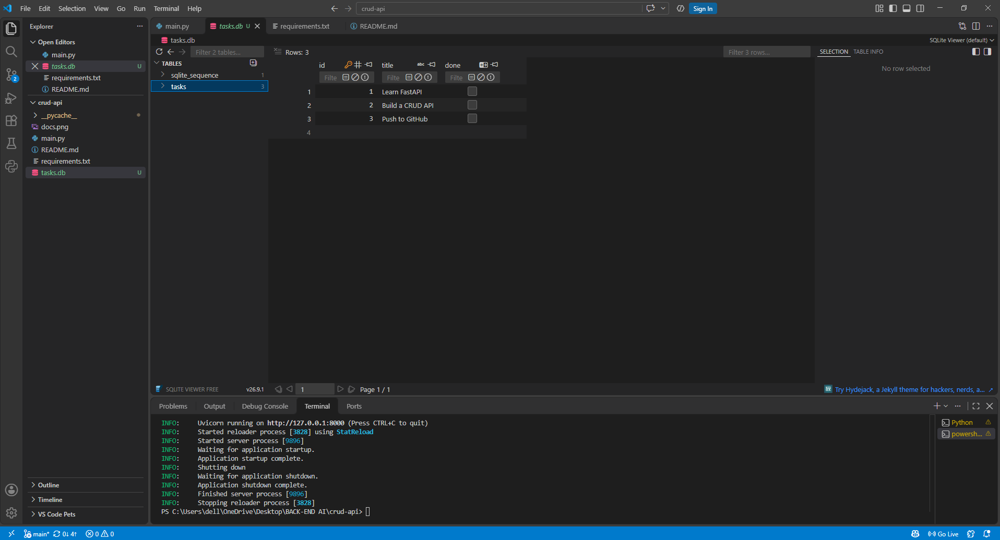

# Task API (SQLite version)

A to-do list API built with FastAPI and SQLite. Tasks are saved in a database file, so they survive server restarts.

## Why SQLite?
SQLite needs no separate database server. The whole database is one file, which makes it perfect for learning and small projects.

## Where is the database?
In `tasks.db`, in the same folder as `main.py`. It is created automatically the first time the app runs, together with the `tasks` table and 3 example tasks (only if the table is empty).

## How to start

```bash
pip install "fastapi[standard]"
fastapi dev main.py
```

Server: http://localhost:8000 · Swagger UI: http://localhost:8000/docs

## Endpoints

| Method | Path | Description | Success | Errors |
|---|---|---|---|---|
| GET | / | API info | 200 | |
| GET | /health | Health check | 200 | |
| GET | /tasks | List all tasks | 200 | |
| GET | /tasks/{id} | Get one task | 200 | 404 |
| POST | /tasks | Create a task | 201 | 400 |
| PUT | /tasks/{id} | Update a task | 200 | 400, 404 |
| DELETE | /tasks/{id} | Delete a task | 204 | 404 |

## Database viewer



## Example SQL query I ran

```sql
SELECT * FROM tasks WHERE done = 1;
```