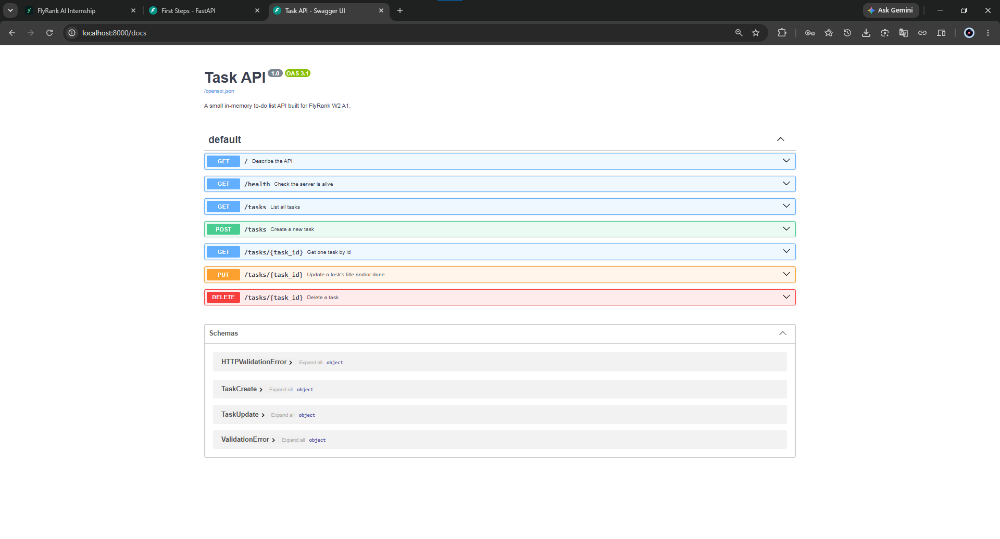

# Task API

A small to-do list API built with FastAPI. Data is stored in memory (no database).

## Install and run

```bash
pip install "fastapi[standard]"
fastapi dev main.py
```

The server runs at http://localhost:8000 and the Swagger UI is at http://localhost:8000/docs.

## Endpoints

| Method | Path | Description | Success | Errors |
|---|---|---|---|---|
| GET | / | API info | 200 | |
| GET | /health | Health check | 200 | |
| GET | /tasks | List all tasks | 200 | |
| GET | /tasks/{id} | Get one task | 200 | 404 |
| POST | /tasks | Create a task | 201 | 400 |
| PUT | /tasks/{id} | Update a task | 200 | 400, 404 |
| DELETE | /tasks/{id} | Delete a task | 204 | 404 |

## Example curl output

```http
HTTP/1.1 200 OK
date: Wed, 25 Nov 2026 22:35:25 GMT
server: uvicorn
content-length: 45
content-type: application/json

{"id":1,"title":"Learn FastAPI","done":false}
```

## Swagger UI

